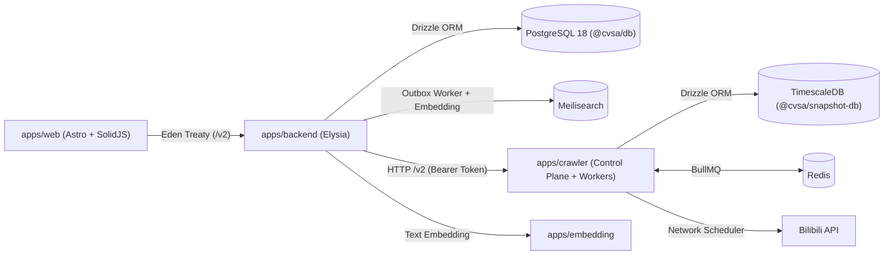

CVSA 由主后端、爬虫守护进程、Web 应用、向量推理服务、部署编排器与文档站六个应用构成，通过共享契约与双数据库隔离支撑编目展示与高吞吐时序爬取两类负载。

## 分层架构与类型契约

后端服务（`apps/backend`）与爬虫控制面（`apps/crawler`）统一遵循 `Handler -> Service -> Repository` 三层职责划分：

1. **Handler 层**（[`apps/backend/src/handlers/`](https://github.com/project-cvsa/cvsa/blob/main/apps/backend/src/handlers/index.ts)、[`apps/crawler/src/controlPlane/`](https://github.com/project-cvsa/cvsa/blob/main/apps/crawler/src/controlPlane/index.ts)）：挂载在 `/v2` 前缀下，负责解析请求并引用 `@cvsa/contracts` 中的 Zod Schema 做边界校验。Handler 不包含业务逻辑，也不使用 `try-catch` 吞掉异常。
2. **Service 层**（`packages/catalog`、`packages/authentication`、`apps/crawler/src/crawler`）：承载领域规则、CASL 权限判定与事务编排。发生可预期的业务或权限错误时，直接抛出 `AppError`，由全局错误处理器统一映射 HTTP 状态码与国际化响应，并附带 `X-Trace-ID` 链路标识。
3. **Repository 层**：封装 Drizzle ORM 查询或参数化 SQL，通过接口与实现分离，使领域服务可在单元测试中替换为内存 fake store。
4. **共享契约层（`@cvsa/contracts` 与 `@api-contract`）**：所有跨服务 DTO 与校验规则集中在 `packages/contracts` 并通过 `z.infer` 导出类型。`apps/backend/src/apiContract.ts` 仅导出 `type App`，`apps/web` 通过类型路径别名 `@api-contract` 结合 Eden Treaty 获得端到端类型推导，不引入后端运行时依赖。

## 双数据库隔离与数据流向

系统将低频强一致的编目业务数据与高频追加写入的爬虫时序数据拆分为两个独立数据库：

- **主库（PostgreSQL 18 / `@cvsa/db`）**：按业务域划分为 `core`（曲目、专辑、创作者、歌手、引擎与演唱关系）、`meta`（角色、权限、语言与外部平台映射）、`platform`（系统配置与搜索同步 outbox）与 `auth`（Better Auth 账号、会话、邀请码与兑换记录）四个 Schema。
- **时序与发现库（TimescaleDB / `@cvsa/snapshot-db`）**：承载 Bilibili 视频元数据（`bilibili_video_metadata`）、元数据变更历史、视频关联图（`bilibili_video_relation`）、调度状态表（`video_tracking`）、时序快照超表（`video_snapshot`）、最新快照物化缓存（`latest_video_snapshot`）、里程碑记录（`video_milestone`）、发现样本与双层标注策展表（`discovery_sample`、`video_annotation`、`video_curation`），以及爬虫运行时配置与统计表。

## 异步流水线与搜索同步

- **Outbox 与混合搜索**：主库 `core` 中的编目变更在事务内写入 outbox 记录，由 `apps/backend` 内嵌的 BullMQ Outbox Worker 异步消费，结合 `apps/embedding` 生成向量并同步至 Meilisearch。
- **视频发现与分类推理**：`apps/crawler` 通过搜索巡检（Search Rover）、热榜采样（Hot Sample）、推荐关联图（可动态开关）及手动摄入收集候选视频，先执行确定性白名单规则，再交由受控子进程托管的 ONNX `akari` 模型判断是否为歌声合成曲目。
- **可观测性与指标统计**：`@cvsa/observability` 与 `@cvsa/logger` 在服务内维护 OpenTelemetry Span 并向 Pino 日志注入 Trace ID；当配置 `OTEL_EXPORTER_OTLP_ENDPOINT` 时向 SigNoz 等采集端上报链路与指标。

## 部署拓扑与变更规划

生产环境与本地基础设施均由根目录 [`docker-compose.yml`](https://github.com/project-cvsa/cvsa/blob/main/docker-compose.yml) 与 [`Dockerfile`](https://github.com/project-cvsa/cvsa/blob/main/Dockerfile) 定义。数据库结构变更通过版本化 Drizzle 迁移脚本在容器启动时执行，不以 `drizzle-kit push` 替代生产迁移。`apps/deploy` 提供的 `plan.ts` 根据 Turborepo `--affected` 产物与服务间级联依赖规划需要重建与发布的服务镜像，配合 GitHub Actions `Release & Deploy` 工作流推送至 GHCR。

## 相关文档

- [仓库布局](./repository.md)：各目录与包的完整清单。
- [接口与共享契约规约](./specs/api-and-contracts.md)：路由前缀、Zod Schema 与错误体系细节。
- [爬虫发现、策展与追踪规约](./specs/crawler-and-curation.md)：发现筛选流、双层标注与追踪状态机。
- [架构决策记录 (ADR)](/zh/decisions)：查看上述架构拆分的演进背景与权衡。
